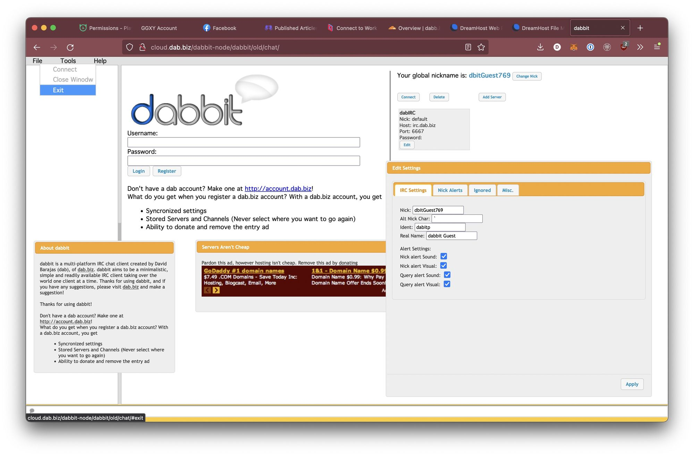
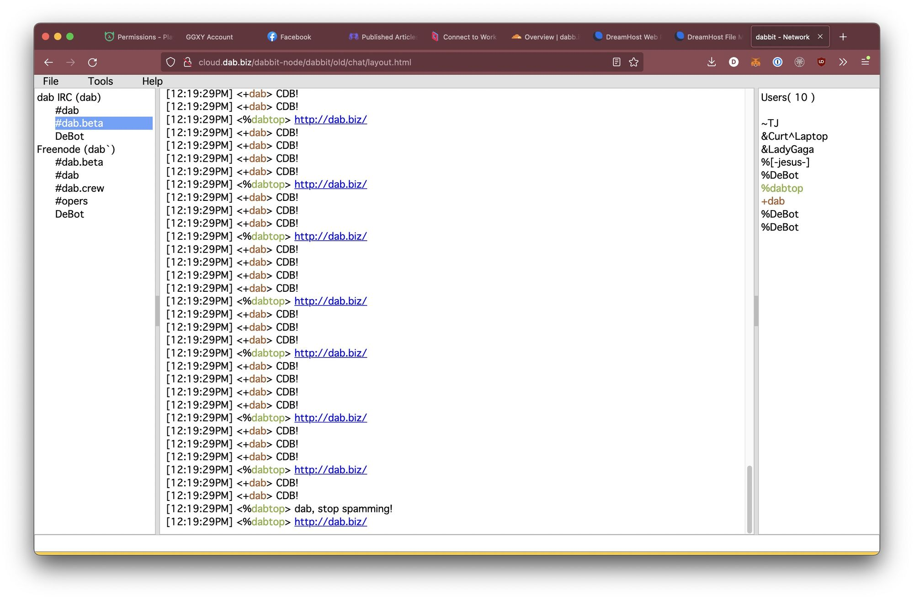
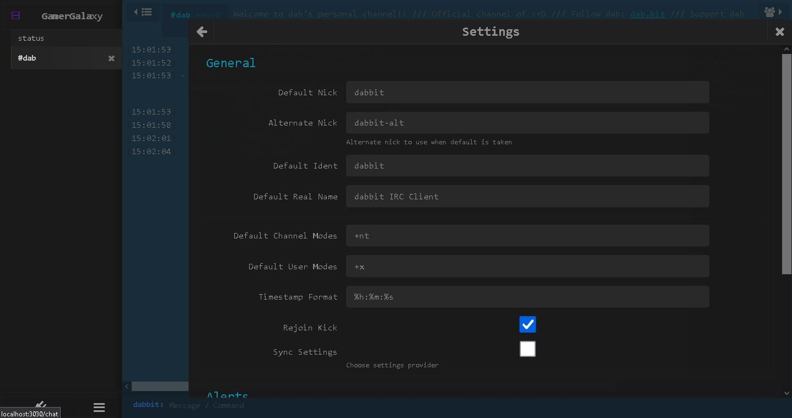

dabb.it was my IRC client project. Its intent was to become basically what IRCCloud did, before IRCCloud existed. Unfortunately I was too slow to the draw and never released a product. IRC clients were something I was very interested in making. I loved the IRC protocol for its ease of use. Being able to telnet into a server and still communicate (maybe poorly) with people was an incredible thought.

dabb.it started out using jQuery UI and socket.io. I'm not a designer by any means, so this version looked very rough around the edges. Thankfully a community member helped make a refreshed UI. With the new UI, and armed with WebSockets, I rewrote dabb.it with a new backend.

The refreshed dabb.it used Angular for the front end, WebSockets for the communication layer, and Node.js with a WebSocket server package from npm. I wrote the IRC parser myself; it's [on GitHub](https://github.com/dabbers/dab.irc.manager/blob/master/sample.ts). This of course was not scalable, but my concern at the time was releasing something usable and scaling later.

