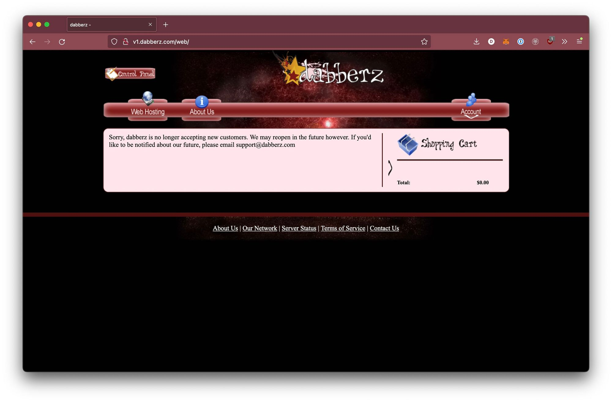
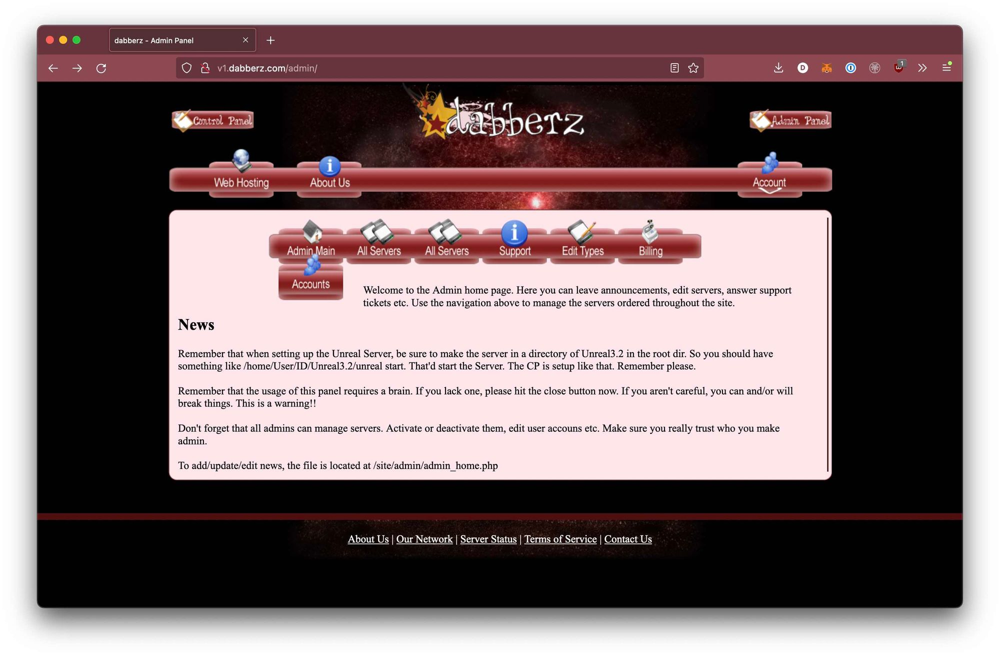
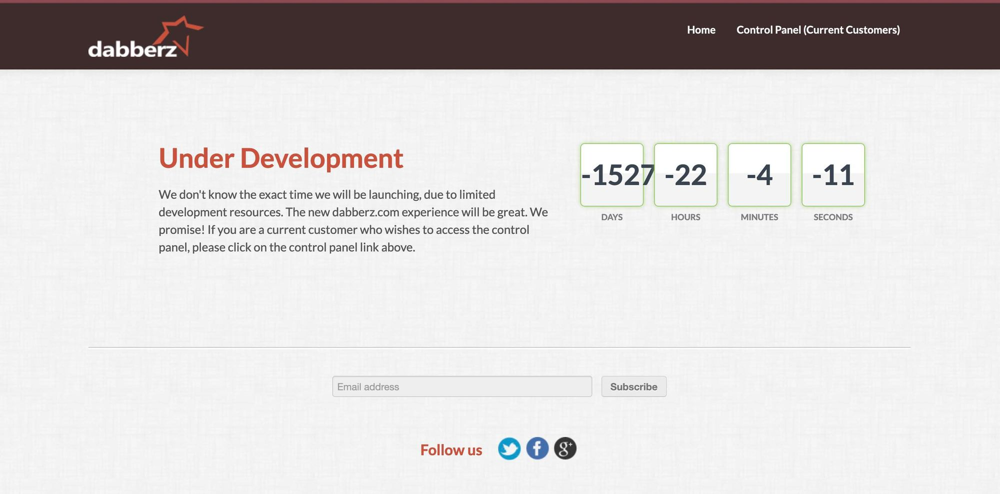

dabberz is a concept for running LLM-driven development in parallel: each task gets its own isolated environment, so several agents can work on a codebase at once without stepping on each other, and nothing they do touches the host. It is still an idea being tested rather than a product.

<!-- TODO: add a current screenshot as cover.png and set `cover: ./cover.png` in the frontmatter. -->

## The name has history

dabberz.com was originally a web host control panel I made to host web and game servers, back in 2010. The game servers were automated; the web hosting wasn't yet. I eventually retired the site because the web hosting business had become so saturated.

The panel was written in PHP, with a few PHP-driven bash scripts running on the machines to handle automatic deploys. The panel would open a proxied SSH session into a server to perform the actions.

Billing was also handled by the panel, with full invoicing and payment support, and there was a ticket system so customers could open support tickets for their services or billing. Each account could create sub-accounts to let other people manage specific services.

The site was quite involved and I'm still pretty proud of it, even if the code was a mess. A few SQL vulnerabilities led me to take down most of its functionality. A modernization project was underway, but I never finished it and probably never will. The old panel stands as a testament to what I was able to finish back in the day.

