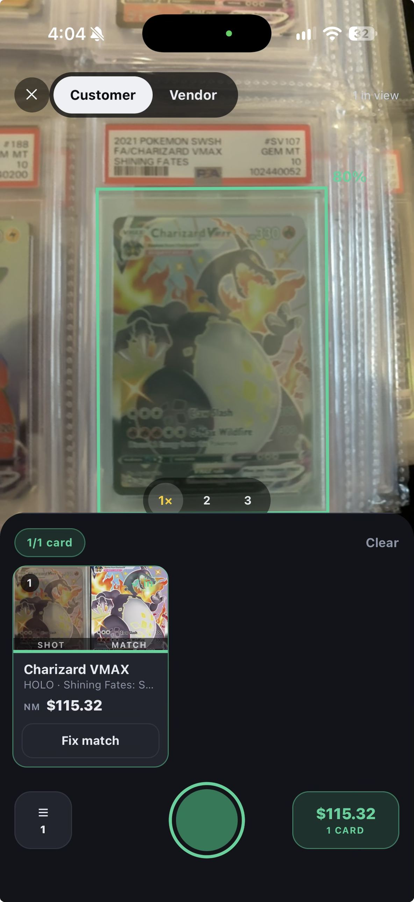

KOmpare is a set of mobile-first tools for people who sell trading cards: the kind of pricing, lookup, and trade math that gets done on a phone between customers, not at a desk.

Point the camera at a card, slabbed or raw, and KOmpare identifies it and pulls the current market price. The scanner runs entirely on the phone, on a model I refined myself, so it works with no signal at all, which at a card show is most of the time. Scanned cards land on either the customer's side or the vendor's side of a trade. Set the percentage of market you're buying or trading at, add cash to balance, and share the finished trade as a link.

The hard part was making all of this work offline. Everything is local-first on SQLite and syncs through PowerSync when there is a connection, so a trade started in a dead spot on the show floor finishes just fine.

It grew out of running [KO Pulls](https://kopulls.com) and shares its backend with [KOllectibles](/projects/kollectibles), which covers the collector side of the same hobby. That shared backend is what lets the same scanner work in both apps.
