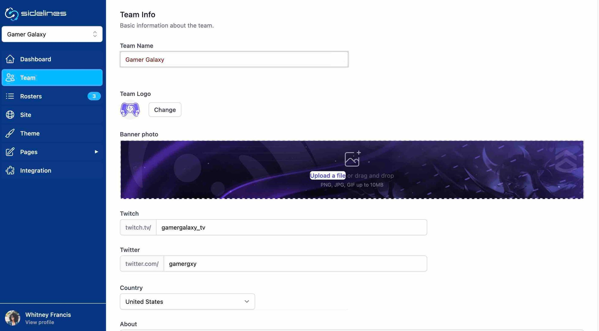

Sidelines was an esports team management system. The front end was Nuxt 3 on a Supabase backend. The stat imports for each player used a mix of backends, Node.js and C#, depending on the external API. Stripe handled payment flows and Zapier ran the async processes.

