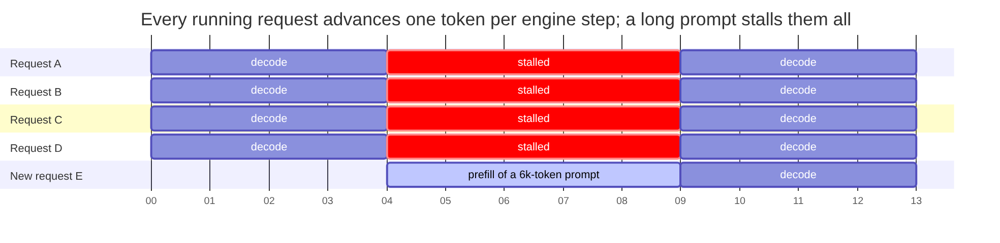
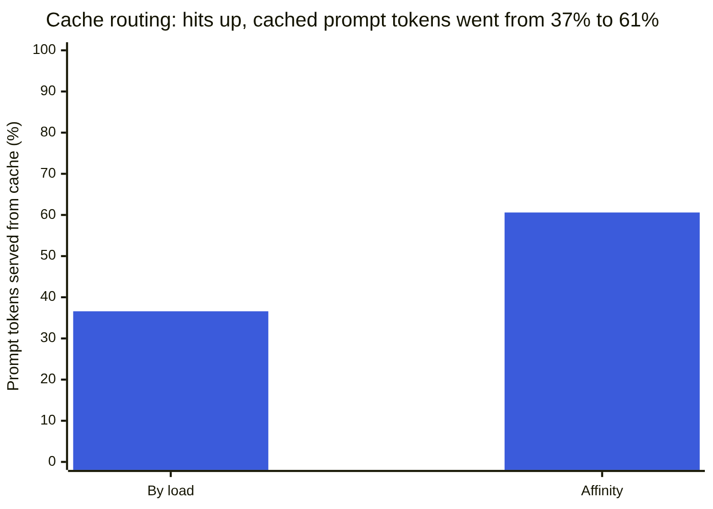
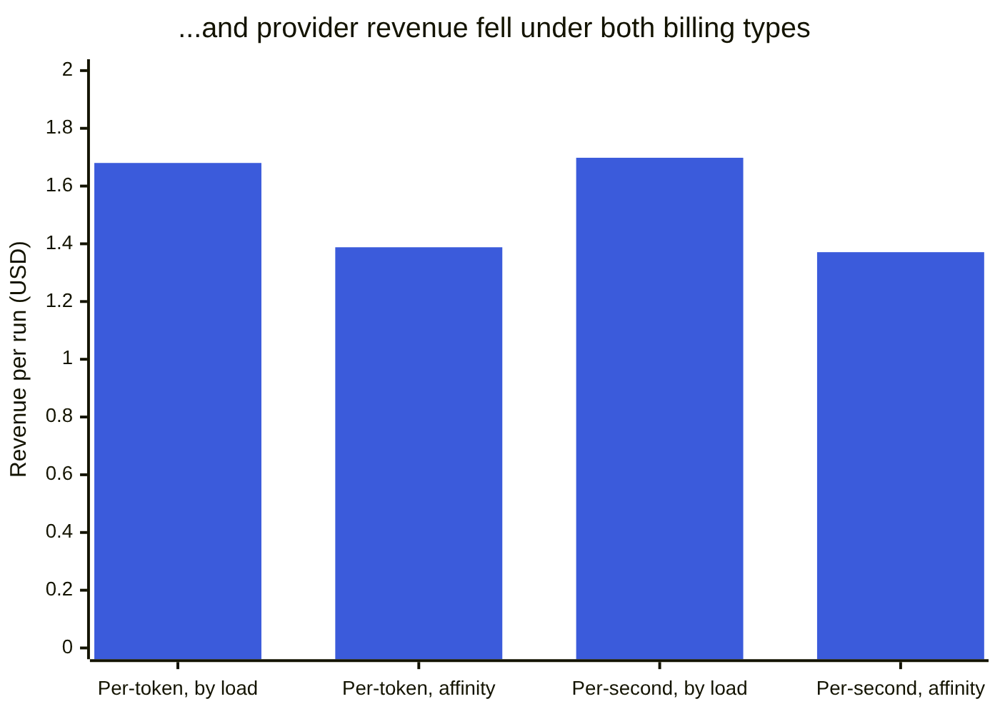
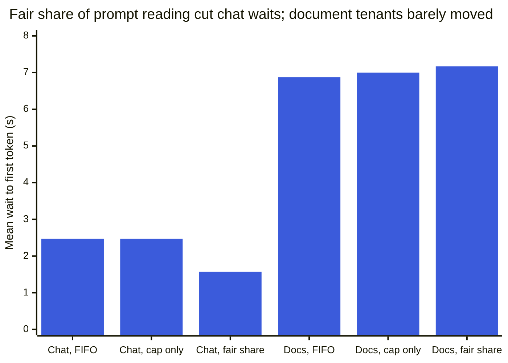
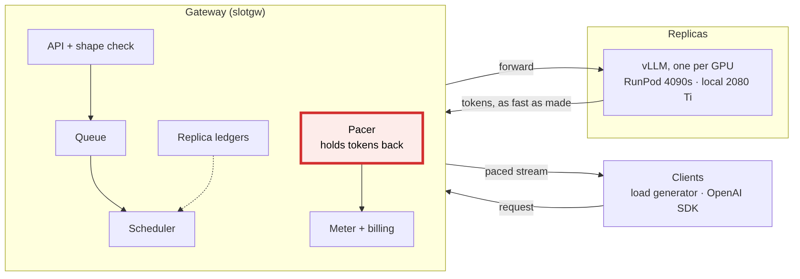
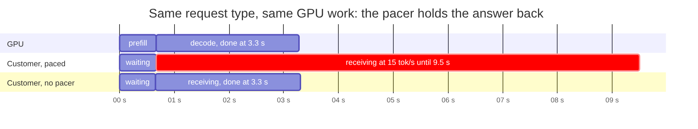
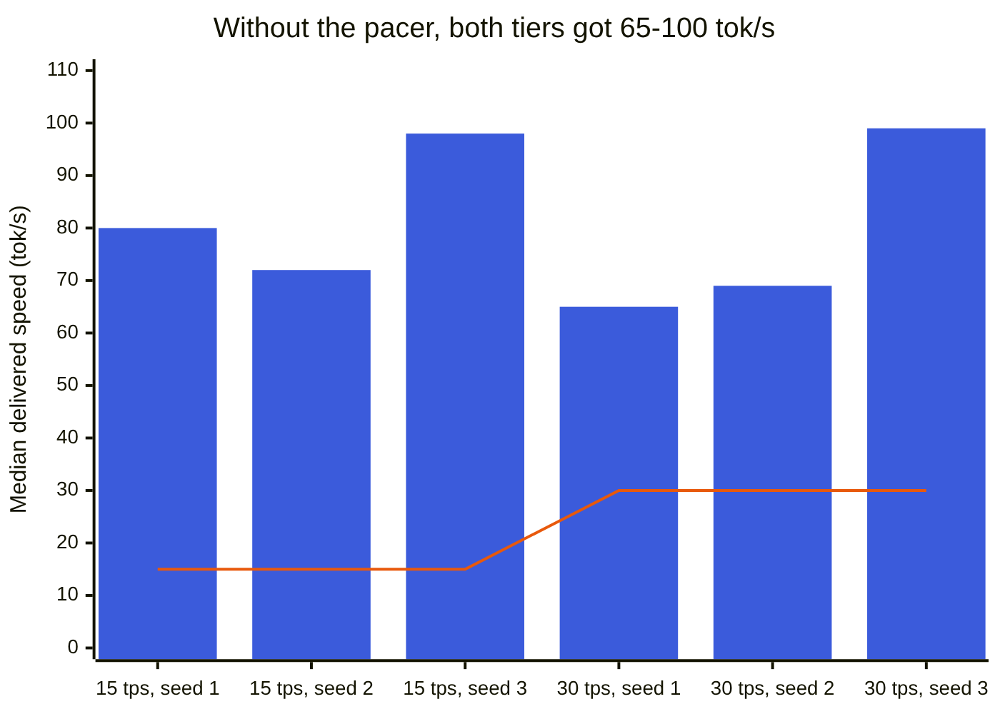
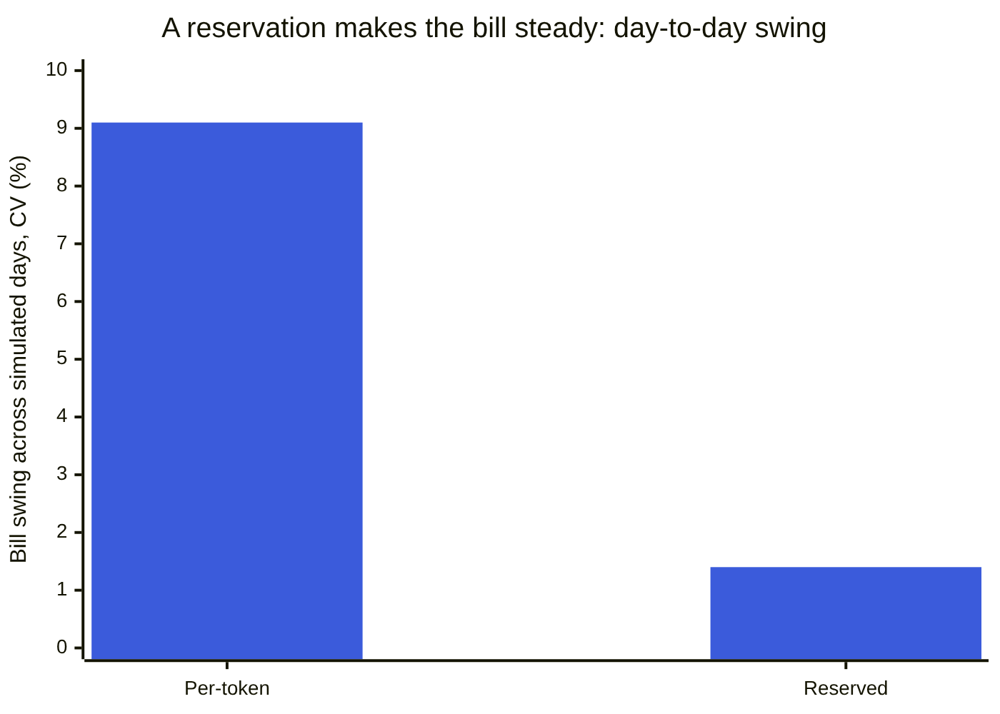
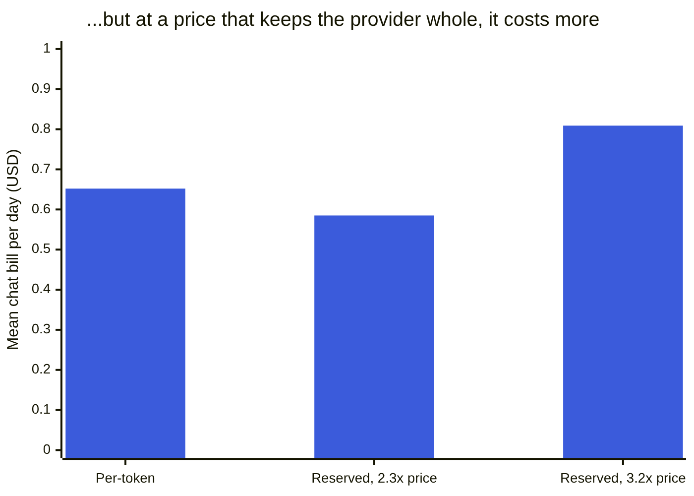

How often do you refresh your token usage to make sure you aren't going over budget? I do it all the time. I never do that with my DigitalOcean droplets, and my CPU and RAM come from a shared pool of machines too. So why do LLMs bill like bandwidth instead of like a server?

At Calendly I work on billing: seats, SKUs, add-ons. A server host bills by slices of CPU and RAM. So I wanted to know: if I sliced a GPU the same way, could customers get a predictable bill while the provider kept its margin? The code and every run behind this post are in [dabbers/hourly-llm](https://github.com/dabbers/hourly-llm).

## The bet

I vibed the design around a SKU that looked like `qwen2.5-7b-8k-30tps`: a 7B model with 8,000 tokens of context at 30 tokens per second. Other tiers raised or lowered the context and TPS. Customers could buy slots on demand or reserve them, the way you'd keep a VM running for your requests. Slots were billed per second of runtime, plus a per-token charge for prompts.

I simulated 4 kinds of customers, a chatbot, an agent, a note-taker that summarizes long documents, and batch jobs. The rough architecture is below. At first I targeted my 2080 Ti for free validations, then when scale questions came into play I ran against 4090s on RunPod.

## What I didn't know, did hurt me

My assumption was the output of the LLM was the expensive part. That's why output tokens cost more, right? Turns out that wasn't the full story. I was shocked by the volume. Traffic ran about 15 prompt tokens per output token, so reading the prompts was a large part of the work. Reading a long prompt stalled every other in-flight request on the same GPU until it finished. vLLM does split prompts into chunks, but I had set them smaller than its default, which made the stall worse. I tried chunk sizes of 256, 512, and 2048: smaller chunks made things worse (missed speed promises went from 44% to 53% at 256), vLLM's default of 2048 helped the most, but no setting got rid of the stall.

The agent customer was hit the hardest. An agent waiting on its next step breaks down when responses aren't fast, and ours missed its promised speed 56% of the time, oops. My time-based bill still charged for prompt tokens, and since that prompt charge was about 70% of the bill, I was basically just billing by token again, but in a way that was masked by GPU performance.

## First pass of optimizations

If the prefill is the expensive, time-consuming part, we should optimize that piece of our process. vLLM keeps a cache of prompts it has already read, the prefix cache. However, vLLM runs one instance per GPU, so I routed each conversation's next turn back to the GPU that served its last one.

This was highly effective. Cache hits went from 37% to 61%, first tokens arrived 36–39% faster, and missed speed promises were cut in half. As with all experiments, not every result was good: the provider took a hit on margin.

Initially I assumed every speed improvement causes the provider to lose money in a time-based billing mechanism. It makes sense when you think about it this way. You make more money when customers spend more time running a request. Caching speeds that up.

The provider did lose, but not because of the billing unit. Repricing those runs with plain per-token billing lost almost the same amount of margin. So it looks like the billing unit had nothing to do with it here. The real crux was the price of a cache hit: about 19% of a fresh token, the median cache-read price providers list for 7B models. A cached request earns far less, and with the same simulated traffic the freed-up capacity was only partly refilled. So better user experience but worse provider margin with per-second margin going down from 51% to 39% and per-token margin going from 51% to 40%. This was the first clue that billing by time might not actually be the unique unit I initially theorized.

## Memory optimizations

At 60 tps, an fp16 cache gave a 4090 22 seats (requests it could serve at once). fp8 fits 1.98× the tokens and decodes faster, which would have raised that to about 41. Would more seats per GPU finally make speed matter more than token count? Unfortunately fp8 didn't work with the model and vLLM version I used on the 4090: 0 of 30 sample replies were usable, just garbled nonsense. But it's worth revisiting if I can find the time (and budget) with a model that ships calibrated fp8 scales.

## Wait for the right GPU

So if matching a cache against a GPU worked this well, what if we made clients wait just a smidge longer before going to a fresh GPU?

Not really. Even a 500ms hold changed almost nothing. The old GPU was usually still full, so the request ended up somewhere else anyway. What worked was moving the idea into the queue: when a GPU freed a seat, a waiting request whose cache lived there could jump a few spots ahead to take it. On the busiest simulated traffic pattern, the wait to start dropped from 5.75 to 2.48 seconds.

## Prefill optimizations

From here on, to save budget, I ran locally on the 2080 Ti with a smaller 3B model instead of the 7B on the 4090s. Okay so if cache is helping, and prefill for new requests hurts everyone else on the GPU, what if we shared the prefill fairly, based on what each customer paid for? A long document-filled prompt would cause every chat request on a GPU to stall while it was being read. Changing the queue order based on what they paid for could spread the load. Chat wait times dropped 27–46%. Big document requests waited about 3% longer, and only two long documents timed out. Fair share was a huge win for customers, but it didn't change the gap between time-based and usage-based billing.

## Stop and think about it for a second…

One thing I caught along the way: the coding agent kept calling the TPS a floor, a minimum we promised. Most offerings treat a rate as a ceiling, an "up to" promise, so I switched both the output and input speeds to ceilings and billed by the slot-hour. That barely changed anything; every hourly variant kept landing right next to usage billing. Let's go look at the diagram above. What's the pacer? Let's ask AI:

> **Me:** Does the pacer handle the actual token output? as in, the GPU is still spilling as much tokens out for all the requests at a time as it can? and we're artificially limiting the output?
>
> **Claude:** Yes. vLLM knows nothing about shapes. Each engine generates as fast as its current batch allows, for every request at once. The gateway takes those tokens into a per-request buffer, and the pacer releases them to the client at the shape's speed, plus any lent burst. So the 30 tps a customer sees is an artificial cap on top of whatever the GPU actually produces

Bingo. We weren't actually billing by the GPU's time to process requests. The pacer just held finished tokens back so the stream looked like 30 tps. Unlike a CPU, each GPU step moves every request in the batch forward at once. The best move is to finish each request as fast as possible so its seat frees up for the next one. That explains why selling speed never helped time-based billing.

I had asked the AI to build a system that billed by time using the throughput as the gating mechanism. The agent didn't push back, and I didn't know enough to see that it made no sense. It worked through the requirements until I finally noticed it.

I think in hindsight, I should have spent more time understanding what vLLM was, how token prefill works, and how the GPU actually steps through each request at once. That would have shifted my opinions drastically up front. Next time, I'll learn how the system works before I start building on top of it.

Let's step back. What if we bill by a more precious resource? Say, the seats available in a GPU.

## What's the actually valuable GPU resource?

Back to my VM comparison. What do we buy with a VM? Very rarely are you offered a CPU clockspeed. A vCPU count is how many cores you get, not how fast they are.

The true equivalent in a GPU would be the seat count, the number of requests that fit in memory at once.

With the artificial speed caps removed and billing by seat, answers arrived 57–72% sooner, obviously. To match per-token revenue, slots had to be priced 2.1–2.6× the original slot price, because an uncapped slot did far more work than its rate. Even then, customers wanted 12–18 slots at their busiest against the 8 my 2080 Ti actually had.

## Tokens and GPU time are proxies for each other

A GPU's real limit is memory: how many requests fit at once. Once memory is the cap, output tracks GPU time closely, so tokens become a solid measure of what the GPU costs.

The biggest shift was in who paid for the idle GPU time. Under usage-based billing, the provider builds the spare capacity into the margin. With time-based billing, the customer needs to pay for the idle time or face a higher markup beyond what usage-based yielded. Customers who reserved enough slots to cover 95% of their busiest moments paid 1.2–1.7× their per-token bill, and in return their bill moved only 1–1.4% day to day, against about 9% on per-token. So a predictable bill is achievable; it just costs a premium. That's probably why providers sell commitments, like prepaid spend or provisioned throughput (Azure PTUs, Bedrock Provisioned Throughput), on top of per-token billing instead of replacing it.

| Multiplier | Compared to | What it means |
| --- | --- | --- |
| 3.2× | The on-demand price per second | The lowest reservation price that matched the provider's baseline margin (52% vs 50%). My original 2.3× left it at 43% |
| 1.2–1.7× | The customer's per-token bill | What a reserved customer paid at 3.2×, for a bill that moved about 1% day to day |

I think the truer parallel between LLM and traditional hosting providers would be serverless. You pay not just for output but the time to keep an endpoint warm and idle.

Billing for this is far from simple given the expense of GPU memory. I do believe there's a world where time-based billing works for LLMs in a far larger scale, and more optimal delivery and routing. Unfortunately my $150 budget at RunPod won't ever touch that kind of experiment.

The gateway, the load generator and the reports for every stage are in the [hourly-llm repo](https://github.com/dabbers/hourly-llm). Full numbers for every stage are in [RESULTS.md](https://github.com/dabbers/hourly-llm/blob/main/docs/RESULTS.md).
